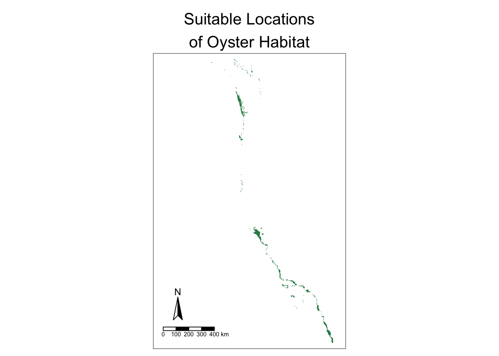
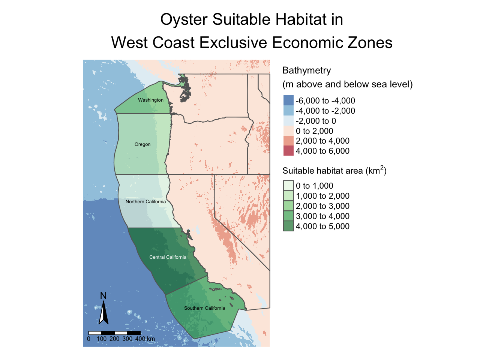
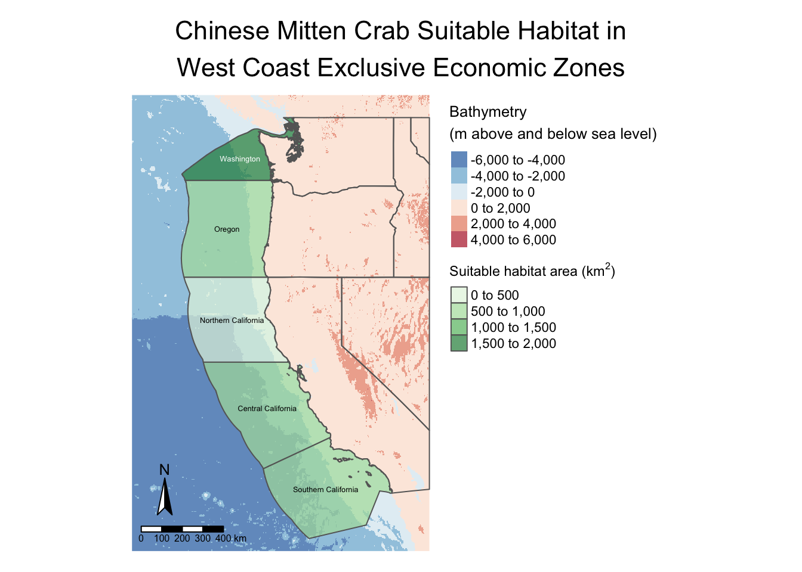

# Prioritizing Potential Aquaculture
## A Functional Analysis of West Coast Economic Zones
Author: Ian Morris-Sibaja


A large mussel farming operation is proposed for the waters off Ventura.
Photo by South Australian Research and Development Institute via NOAA [Cal Matters](https://calmatters.org/environment/2020/05/california-shellfish-farming-aquaculture/)

## About

This project takes a look at suitable habitats for marine aquaculture species along the U.S. West Coast, highlighting its potential as a sustainable protein source. Key objectives include:

- Mapping species-specific habitats based on sea surface temperature and depth.
- Streamlining geospatial data collection, processing, and visualization.
- Creating a reusable workflow function.

Originally completed 2024-12-02. The source raster/vector datasets (SST, bathymetry, and EEZ shapefiles) are no longer available, so the code below is shown for reference rather than re-executed — the figures and tables reflect the original computed output.

```{r}
#| code-fold: true
#| code-summary: "Load packages"
library(terra)
library(sf)
library(tidyverse)
library(here)
library(tmap)
library(kableExtra)
```

## Data Pre-Processing

### Prepare Data

We begin by loading surface economic zone, bathymetry, and sea surface temperature data.

```{r}
#| code-fold: true
#| code-summary: "Load data"
WC_EEZ <- sf::read_sf(here("data", "wc_regions_clean.shp"))
bath <- terra::rast(here("data", "depth.tif"))
```

We want to stack the sea surface temperature (SST) raster files into one raster for ease of calculations.

```{r}
SST_files <- list.files(
  here("data"), pattern = "average",
  full.names = TRUE)

SST_stack <- terra::rast(SST_files)
names(SST_stack) <- c("2008", "2009", "2010", "2011", "2012")
```

Now that the data is loaded, we need to ensure each CRS is equal.

```{r}
#| code-fold: true
#| code-summary: "Check if CRS of EEZ SF object is 4326, update if not"
if(sf::st_crs(WC_EEZ) == sf::st_crs(4326)) {
  print("Coordinate reference systems match")
} else{
  warning("Updating coordinate reference systems to match")
  # transform data to match
  WC_EEZ <- sf::st_transform(WC_EEZ, st_crs(4326))
}
```

```{r}
#| code-fold: true
#| code-summary: "Check if CRS of bathymetry raster is 4326, update if not"
if(terra::crs(bath) == terra::crs("EPSG:4326")) {
  print("Coordinate reference systems match")
} else{
  warning("Updating coordinate reference systems to match")
  # transform data to match
  bath <- project(bath, crs("EPSG:4326"))
}
```

```{r}
#| code-fold: true
#| warning: true
#| code-summary: "Check if CRS of SST raster is 4326, update if not"
if(terra::crs(SST_stack) == terra::crs("EPSG:4326")) {
  print("Coordinate reference systems match")
} else{
  warning("Updating coordinate reference systems to match")
  # transform data to match
  SST_stack <- terra::project(SST_stack, crs("EPSG:4326"))
}
```

### Process data

#### We began by reprocessing the SST and depth data

All have slightly different resolutions, extents, and positions, so we must normalize them before visualizing.

Creating single raster of mean SST will allow us to visualize the data.

```{r}
SST_mean_K <- terra::mean(SST_stack)
```

We convert the SST from Kelvin to Celsius to directly compare suitable habitats from our source.

```{r}
SST_mean_C <- SST_mean_K - 273.15
```

Crop the raster extents to match.

```{r}
bath <- terra::crop(bath, SST_mean_C)
```

Resample the depth data to match the resolution of the SST data using the nearest neighbor approach.

```{r}
bath <- terra::resample(bath, SST_mean_C, "near")
```

Ensure the depth and SST rasters match in resolution, extent, and coordinate reference systems.

```{r}
#| code-fold: true
if(all(terra::res(bath) == terra::res(SST_mean_C))) {
  if(terra::crs(bath) == terra::crs(SST_mean_C)) {
    if(terra::ext(bath) == terra::ext(SST_mean_C)){
      print("All match")
    }else{
      stop("extenet does not match")
    }
  }else{
    stop("CRS does not match")
  }
}else{
  stop("Resolution does not match")
}
```

One more check: if it stacks, then they all match!

```{r}
raster::stack(c(SST_mean_C, bath))
```

We can now directly compare and manipulate the data.

## General Workflow

Before we create a reproducible workflow, let's first determine how to create a general workflow for a single species.

### Find suitable locations

To find suitable locations, we can reclassify the data between suitable or unsuitable habitats.

```{r}
# reclassify erroneous values as NA
SST_rcl <- matrix(c(-Inf, 11, NA,
                 11, 30, 1,
                30, Inf, NA), ncol = 3, byrow = TRUE)

bath_rcl <- matrix(c(-Inf, -70, NA,
                 -70, 0, 1,
                0, Inf, NA), ncol = 3, byrow = TRUE)

SST_mean_C_rcl <- classify(SST_mean_C, rcl = SST_rcl)
bath_rcl <- classify(bath, rcl = bath_rcl)
```

Now that are values are either 1 or NA, we can preform raster algebra to categorize our suitable habitats by determining which cells are both set to 1 between them.

```{r}
# Create a suitable location raster
suitable_loc <- (SST_mean_C_rcl*bath_rcl)
```

Visualize our suitable locations.

```{r}
tm_shape(suitable_loc) +
  tm_raster(palette = "seagreen") +
  tm_compass(size = 2,
             position = c("left", "bottom")) +
  tm_scale_bar(position = c("left", "bottom")) +
  tm_layout(legend.show = FALSE,
            main.title = "Suitable Locations\nof Oyster Habitat",
            main.title.size = 1.35,
            main.title.position = c("center", "top"))
```



With our rough estimate of suitable locations we can continue to find the most suitable economic zones for our suitable habitats.

### Determine the most suitable EEZ

To determine the most suitable Exclusive Economic Zone, we begin by ranking them by total area of suitable habitats.

Select suitable cells within West Coast EEZs.

```{r}
# Rasterize our economic zones
EEZ_raster <- terra::rasterize(WC_EEZ, suitable_loc, field="rgn_id")

# Categorize our suitable locations raster
EEZ_raster <- (EEZ_raster*suitable_loc)
```

Calculate the area of each cell in kilometers and categorize them.

```{r}
# Calculate the area of each cell
cell_area <- terra::cellSize(EEZ_raster, unit = "km")
# Categorize the total area of each cell
zone_area <- terra::zonal(cell_area, EEZ_raster, fun="sum", unit="km")
# Visualize area with a table
kable(zone_area, digits = 2,
      caption = "Suitable area by exclusive economic zone",
      col.names = c("EEZ Region", "Area (km^2)"))
```

| EEZ Region | Area (km^2) |
|---:|---:|
| 1 | 1074.26 |
| 2 | 178.02 |
| 3 | 4069.57 |
| 4 | 3508.19 |
| 5 | 2378.28 |

: Suitable area by exclusive economic zone

Plot our suitable locations.

```{r}
#| code-fold: true
#| code-summary: "Clean up data for plotting"
#| warning: FALSE
# Join dataframes to map our eez area with geometries
EEZ_join <- left_join(WC_EEZ, zone_area, by = "rgn_id")

# Create and crop state variable for visualization
us_states <- spData::us_states %>%
  filter(NAME  %in% c("California", "Washington", "Oregon",
                      "Nevada", "Idaho", "Montana")) %>%
  st_set_crs(4326)

# Grab bbox of previous raster
EEZ_raster_bbox <- st_bbox(EEZ_raster) %>%
  st_as_sfc()

# Crop our states
us_states <- st_intersection(us_states, EEZ_raster_bbox)
```

```{r}
#| code-fold: true
#| code-summary: "Plot the data"
tm_shape(bath) +
  tm_raster(palette = "-RdBu",
            title = "Bathymetry\n(m above and below sea level)",
            alpha = 0.7,
            midpoint = 0,
            legend.show = TRUE) +
  tm_shape(us_states) +
  tm_borders() +
  tm_shape(EEZ_join, raster.downsample = TRUE) +
  tm_polygons(col = "area",
              palette = "Greens",
              alpha = 0.7,
              title = expression("Suitable habitat area (km"^2*")")) +
  tm_text("rgn", size = 0.4) +
  tm_compass(size = 2,
             position = c("left", "bottom")) +
  tm_scale_bar(position = c("left", "bottom")) +
  tm_layout(legend.outside = TRUE,
            frame = FALSE,
            main.title = "Oyster Suitable Habitat in\nWest Coast Exclusive Economic Zones",
            main.title.size = 1.35,
            main.title.position = c("center", "top"))
```



## Reproducible Workflow

Next we will pull only the most necessary bits of our code to create a function, easing reproducibility in creating these maps.

```{r}
suitable_location <- function(min_SST, max_SST, min_depth, max_depth, species_name){
  # reclassify erroneous values as NA
  SST_rcl <- matrix(c(-Inf, min_SST, NA,
                      min_SST, max_SST, 1,
                      max_SST, Inf, NA), ncol = 3, byrow = TRUE)

  bath_rcl <- matrix(c(-Inf, min_depth, NA,
                       min_depth, max_depth, 1,
                       max_depth, Inf, NA), ncol = 3, byrow = TRUE)

  SST_mean_C_rcl <- classify(SST_mean_C, rcl = SST_rcl)
  bath_rcl <- classify(bath, rcl = bath_rcl)

  # Create a suitable location raster
  suitable_loc <- (SST_mean_C_rcl*bath_rcl)
  # Rasterize our economic zones
  EEZ_raster <- terra::rasterize(WC_EEZ, suitable_loc, field="rgn_id")
  # Categorize our suitable locations raster
  EEZ_raster <- (EEZ_raster*suitable_loc)

  # Calculate the area of each cell
  cell_area <- terra::cellSize(EEZ_raster, unit = "km")
  # Categorize the total area of each cell
  zone_area <- terra::zonal(cell_area, EEZ_raster, fun="sum", unit="km")

  # Join dataframes to map our eez area with geometries
  EEZ_join <- left_join(WC_EEZ, zone_area, by = "rgn_id")
  # Create and crop state variable for visualization
  us_states <- spData::us_states %>%
    filter(NAME  %in% c("California", "Washington", "Oregon",
                        "Nevada", "Idaho", "Montana")) %>%
    st_transform(crs=4326)

  # Grab bbox of previous raster
  EEZ_raster_bbox <- st_bbox(EEZ_raster) %>%
    st_as_sfc()
  # Crop our states
  us_states <- st_intersection(us_states, EEZ_raster_bbox)

  # Plot
  tm_shape(bath) +
    tm_raster(palette = "-RdBu",
              title ="Bathymetry\n(m above and below sea level)",
              alpha = 0.7,
              midpoint = 0,
              legend.show = TRUE) +
    tm_shape(us_states) +
    tm_borders() +
    tm_shape(EEZ_join, raster.downsample = TRUE) +
    tm_polygons(col = "area",
                palette = "Greens",
                alpha = 0.7,
                title = expression("Suitable habitat area (km"^2*")")) +
    tm_text("rgn", size = 0.4) +
    tm_compass(size = 2,
               position = c("left", "bottom")) +
    tm_scale_bar(position = c("left", "bottom")) +
    tm_layout(legend.outside = TRUE,
              frame = FALSE,
              main.title = paste(species_name,
                                 "Suitable Habitat in\nWest Coast Exclusive Economic Zones"),
              main.title.size = 1.35,
              main.title.position = c("center", "top"))
}
```

Let's test our function.

```{r}
#| warning: false
suitable_location(min_SST=11, max_SST=30,
                  min_depth=-70, max_depth=0,
                  species_name="Oyster")
```


It's the same as before! We confirmed our function is reproducible. Now to try with a new species, the Chinese Mitten Crab, with a temperature range of 5-27°C and depth range of 0-25 m.

```{r}
#| warning: false
suitable_location(min_SST=5, max_SST=27,
                  min_depth=-25, max_depth=0,
                  species_name="Chinese Mitten Crab")
```



## Conclusion

To create a reproducible workflow, we first created one that works for a single species. We then found variables necessary to replace when creating a map for each different species. With the variables replaced, our function was created. Now we can insert our arguments to create a map of any species that we have the temperature and depth range of. This function helps scientists and policymakers identify optimal West Coast aquaculture sites, supporting efforts to ease pressure on terrestrial food systems amid climate and land-use challenges.

## Citations

| Data | Citation | Link |
|---|---|---|
| Sea Surface Temperature Data | NOAA Coral Reef Watch. 2019, updated daily. NOAA Coral Reef Watch Version 3.1 Daily 5km Satellite Regional Virtual Station Time Series Data. College Park, Maryland, USA: NOAA Coral Reef Watch. Data set accessed 2024-11-20 at https://coralreefwatch.noaa.gov/product/vs/data.php. | [NOAA Coral Reef Watch](https://coralreefwatch.noaa.gov/product/5km/index_5km_ssta.php) |
| Bathymetry Data | GEBCO Compilation Group (2022) GEBCO_2022 Grid (doi:10.5285/e0f0bb80-ab44-2739-e053-6c86abc0289c) | [GEBCO](https://www.gebco.net/data_and_products/gridded_bathymetry_data/#area) |
| Exclusive Economic Zones | Flanders Marine Institute (2024): MarineRegions.org. Available online at www.marineregions.org. Consulted on 2024-11-30. | [Marine Regions](https://www.marineregions.org/eez.php) |
| Sea Life Base Aquaculture Data | Palomares, M.L.D. and D. Pauly. Editors. 2024. SeaLifeBase. World Wide Web electronic publication. www.sealifebase.org, version (08/2024). | [Sea Life Base](https://www.sealifebase.ca/search.php) |
